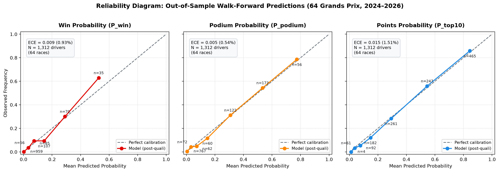

# Grid Odds: an F1 Race Outcome Predictor

[](https://github.com/aditbhavesh/f1-race-predictor/actions/workflows/ci.yml)

Chances of winning, reaching the podium, and scoring points for every driver, computed by a model tested exclusively on races it had never seen. An interactive dashboard forecasts the next Grand Prix, lets you set any custom starting grid with real-time Monte Carlo re-calculation in the browser, and explores predictions across 64 past races.

> ⚡ **Automated Pipeline:** This dashboard runs on **GitHub Actions**. Every Tuesday at 06:00 UTC (and on-demand), an automated workflow pulls the official FIA schedule via FastF1, detects the upcoming Grand Prix, refits the monotonic gradient-boosting model, runs 20,000 Monte Carlo simulations, and publishes fresh predictions to GitHub Pages.

[](https://aditbhavesh.github.io/f1-race-predictor/)

*Interactive Monte Carlo Dashboard running live at [aditbhavesh.github.io/f1-race-predictor](https://aditbhavesh.github.io/f1-race-predictor/)*

---

## 🛡️ Responsible Use & Educational Disclaimer

> **Notice:** Grid Odds is an independent, non-commercial, open-source educational and portfolio project developed strictly for academic research and Formula 1 enthusiast exploration, built using public FastF1 timing and telemetry data (2022–2026).
> 
> - **NOT Gambling or Financial Advice:** These predictions are probabilistic mathematical Monte Carlo simulations and are **strictly NOT intended for sports betting, gambling, or commercial wagering**. Provided "as is" without warranty of accuracy.
> - **Inherent Randomness:** Formula 1 racing involves stochastic events—including collisions, mechanical failures, unpredictable safety cars, weather shifts, and stewarding penalties—which cannot be predicted with certainty.
> - **No Affiliation & Trademarks:** This project is independent and non-commercial. It is not affiliated with, sponsored by, or endorsed by Formula 1, Formula One Licensing B.V., the FIA, or any Formula 1 team. **FORMULA 1, F1, GRAND PRIX**, and related marks are trademarks of Formula One Licensing B.V. All team and driver names are used purely for nominative identification and informational reference.

---

## Results (64 test races, 2024 to Singapore 2026, refitted before every race)

| Method | Win Brier | Podium Brier | Points Brier | Winner right | Podium of 3 | Points of 10 |
|---|---|---|---|---|---|---|
| **Model before qualifying** | **0.042** | **0.087** | **0.168** | **20%** | **1.5** | **7.4** |
| Baseline: championship order | 0.040 | 0.085 | 0.172 | 27% | 1.7 | 7.4 |
| **Model after qualifying** | **0.032** | **0.069** | **0.146** | **58%** | **2.0** | **7.9** |
| Baseline: starting slot | 0.030 | 0.064 | 0.155 | 61% | 2.1 | 7.9 |

*Brier score is the mean squared error of probabilistic odds (lower is better).*

### Key Takeaways
- **Grid Baseline Comparison:** The post-qualifying model roughly ties the naive "starting slot" baseline on top-10 points finishers (7.9 of 10 points finishers correctly identified vs 7.9 for the baseline). It is slightly behind the starting slot baseline on race winner accuracy (58% vs 61%) and on win/podium Brier scores (Win Brier: 0.032 vs 0.030; Podium Brier: 0.069 vs 0.064), but improves upon it on points-scoring probability resolution (Points Brier: 0.146 vs 0.155).
- **Calibrated Probabilities & Empirical Limits:** Overall probability calibration is high, with Expected Calibration Error (ECE) of 0.54% for podiums, 1.51% for points finishes, and 0.93% for race wins across 1,312 driver-races. As shown in the reliability diagram below, podium probabilities are near-perfectly calibrated across all probability levels, while win odds show slight overconfidence in the 10%–20% range and underconfidence for heavy favorites in the 40%–70% range.
- **Added Value Beyond Static Slots:** While starting grid position heavily drives modern Formula 1 outcomes, the model adds capabilities that static historical slot frequencies cannot provide: continuous calibrated probabilities, explicit driver- and team-level retirement (DNF) risk modeling, sensitivity to practice/qualifying pace gaps and grid penalties, and full field-level probability distributions.
- **Interactive In-Browser Simulation:** `dashboard/engine.js` runs Monte Carlo simulations directly on client devices, allowing instant What-If analysis when altering starting grid slots.

### Calibration & Reliability



*Reliability diagram of out-of-sample walk-forward predictions across all 64 test races (1,312 driver-races, 2024 to 2026), evaluated across empirical probability bins with observed bin counts ($n$):*

- **Podium Probability (ECE = 0.54%):** Near-ideal calibration across the entire curve (e.g. 53.4% predicted vs 54.3% observed, $n=173$; 77.4% predicted vs 78.6% observed, $n=56$).
- **Points Probability (ECE = 1.51%):** Strongly calibrated across all deciles, with minor overestimation in the low-probability midfield window (5%–15% predicted vs 5%–12% observed).
- **Win Probability (ECE = 0.93%):** Sharp discrimination for non-contenders ($P < 2\%$, observed 0.1%, $n=959$). The model exhibits moderate overconfidence in the intermediate 10%–20% range (predicted 14.5% vs observed 9.3%) and underconfidence for dominant polesitters in the 40%–70% range (predicted 52.7% vs observed 62.9%).

---

## Architecture & Method

1. **Normalized Grid Percentiles:** Finishing positions are scaled as percentages of the field (0.0 = 1st, 1.0 = last), enabling rigorous cross-comparison between 20-car and 22-car fields.
2. **Leakage-Free Feature Engineering:** Every feature for race $N$ is strictly computed using only races $< N$ (enforced and tested via `tests/test_features.py`).
3. **Monotonic Gradient Boosting:** Ensures that improved recent form or a higher grid slot can never penalize a driver's predicted finish.
4. **Reliability & Noise Modeling:** Logistic regression models retirement risk (DNF), and empirical 5-fold out-of-sample error bands provide realistic stochastic variance during Monte Carlo generation.

---

## Live Automation & GitHub Pages Hosting

The repository includes automated update workflows:

1. **Automated Cron Pipeline (`.github/workflows/update_predictions.yml`):**
   - Runs automatically every Tuesday after race weekend.
   - Syncs any completed race results via `scripts/sync_latest_results.py`.
   - Discovers the next upcoming Grand Prix via `src/f1_calendar.py`.
   - Runs `scripts/export_dashboard.py` and compiles self-contained `index.html`.
   - Commits and pushes changes back to the repository.

2. **Deploying to GitHub Pages:**
   - Live URL: `https://aditbhavesh.github.io/f1-race-predictor/`
   - Configured to deploy automatically from branch **`main`** root.

---

## Local Usage

### Quick Update (Takes ~5 seconds):
```bash
pip install -r requirements.txt
python scripts/auto_update.py
```
Open `index.html` or `dashboard/gridodds.html` in any browser.

### Full Walk-Forward Re-test (Recomputes all 64 historical benchmarks, ~15 mins):
```bash
python run_all.py
```